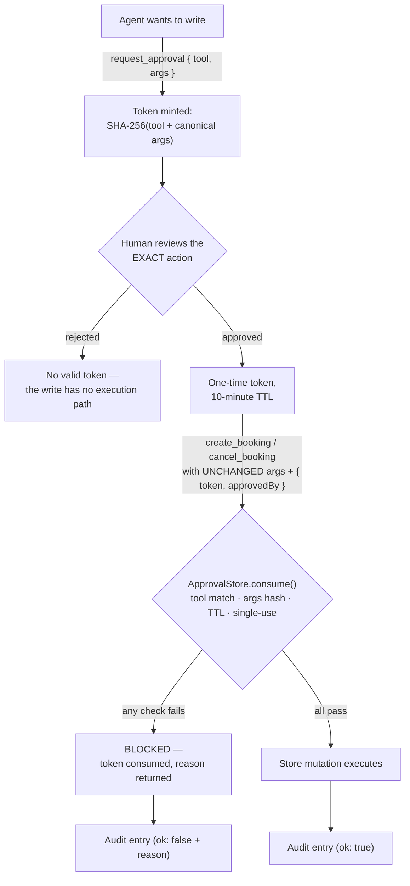

# bookings-mcp

[](https://github.com/EltonC369/bookings-mcp/actions/workflows/ci.yml)

> Replace `EltonC369` in the badge URL after forking/cloning this repository.

An MCP (Model Context Protocol) server that demonstrates production-grade safety patterns for giving AI agents write access to real systems: **strict read/write tool separation** and **approval-gated writes**. Every mutating tool requires a one-time approval token that is cryptographically bound to the exact arguments a human signed off on — change one field after approval and the token is dead.

The domain is a small booking system (customers, bookings, availability) with fictional seed data. The point is not the bookings — it is the pattern for letting an agent *read freely* while *writes stay under human control*, enforced in host code rather than in the prompt.

## Table of contents

- [Key features](#key-features)
- [Tech stack](#tech-stack)
- [Prerequisites](#prerequisites)
- [Getting started](#getting-started)
- [Connecting an MCP client](#connecting-an-mcp-client)
- [Tools](#tools)
- [The approval flow](#the-approval-flow)
- [Security model](#security-model)
- [Project structure](#project-structure)
- [Testing](#testing)
- [Production hardening notes](#production-hardening-notes)
- [License](#license)

## Key features

- **Read/write tool separation** — read tools are annotated with `readOnlyHint: true`; write tools make no such claim and cannot mutate without passing the gate.
- **Approval-gated writes** — `create_booking` and `cancel_booking` require an `{ token, approvedBy }` payload. Without it, the call fails schema validation; with a forged or stale token, it is blocked by the `ApprovalStore`.
- **Args-bound tokens** — each token is bound to `SHA-256(tool name + canonicalized args)` with sorted keys (the `approval` object itself excluded). Any post-approval change to the action invalidates the token.
- **Single-use, 10-minute TTL** — tokens are consumed on first use, even when the call fails, so they cannot be replayed or used to probe the gate.
- **Audit trail** — every tool call (read, write, or approval) is recorded with timestamp, kind, outcome, argument preview, and the reason for any block.
- **Two transports** — stdio for local MCP hosts (Claude Desktop, Claude Code) and stateless Streamable HTTP with optional bearer-token auth for service deployments.
- **Tested end to end** — 19 tests drive a real MCP client against the server through in-memory transports, covering the gate from every angle.

## Tech stack

| Layer | Choice |
|---|---|
| Language | TypeScript (ESM, `strict: true`) |
| Runtime | Node.js >= 20 |
| MCP SDK | `@modelcontextprotocol/sdk` ^1.32.1 |
| Validation | `zod` ^4 |
| HTTP transport | `express` ^5 |
| Tests | `vitest` ^4 (MCP client over `InMemoryTransport`) |
| Build | `tsc` — dev loop with `tsx` |

## Prerequisites

- Node.js **20 or newer**
- npm (the repo ships a `package-lock.json`, so `npm ci` works)

## Getting started

```bash
# 1. install
npm ci                # or: npm install

# 2. verify — 19 tests should pass
npm test

# 3. build
npm run build

# 4a. run over stdio (default transport)
npm start             # node dist/index.js

# 4b. or run over Streamable HTTP during development
npm run dev:http      # tsx src/index.ts --http --port 3270

# 4c. run HTTP with a bearer token (recommended before any exposure)
BOOKINGS_MCP_TOKEN="a-long-random-secret" npm run dev:http
```

Useful scripts:

| Command | What it does |
|---|---|
| `npm run build` | Compile `src/` to `dist/` via `tsc` |
| `npm start` | Run the compiled server over stdio |
| `npm run dev` | Run `src/index.ts` directly over stdio (tsx) |
| `npm run dev:http` | Run over Streamable HTTP on port 3270 (tsx) |
| `npm test` | Run the vitest suite once |
| `npm run test:watch` | Vitest in watch mode |
| `npm run typecheck` | `tsc --noEmit` |

The server prints its startup banner to **stderr** (stdout is reserved for the stdio protocol).

## Connecting an MCP client

### stdio (Claude Desktop / Claude Code)

Add to your MCP client configuration (e.g. `claude_desktop_config.json`):

```json
{
  "mcpServers": {
    "bookings": {
      "command": "node",
      "args": ["/absolute/path/to/bookings-mcp/dist/index.js"]
    }
  }
}
```

No flags are needed — stdio is the default transport. The 7 tools appear as `list_customers`, `get_customer`, `list_bookings`, `check_availability`, `request_approval`, `create_booking`, `cancel_booking`.

### Streamable HTTP (curl)

Start the server with `npm run dev:http` (optionally with `BOOKINGS_MCP_TOKEN`), then speak JSON-RPC to `POST /mcp`. The transport is stateless — no session id is issued, and `GET`/`DELETE /mcp` return `405`.

```bash
BASE=http://127.0.0.1:3270/mcp
# add when a token is configured: -H "Authorization: Bearer $BOOKINGS_MCP_TOKEN"

# initialize
curl -s "$BASE" \
  -H "Content-Type: application/json" \
  -H "Accept: application/json, text/event-stream" \
  -d '{"jsonrpc":"2.0","id":1,"method":"initialize","params":{
        "protocolVersion":"2025-03-26",
        "capabilities":{},
        "clientInfo":{"name":"curl","version":"0.0.0"}}}'

# list tools
curl -s "$BASE" \
  -H "Content-Type: application/json" \
  -H "Accept: application/json, text/event-stream" \
  -d '{"jsonrpc":"2.0","id":2,"method":"tools/list","params":{}}'

# call a read tool
curl -s "$BASE" \
  -H "Content-Type: application/json" \
  -H "Accept: application/json, text/event-stream" \
  -d '{"jsonrpc":"2.0","id":3,"method":"tools/call","params":{
        "name":"check_availability",
        "arguments":{"date":"2026-11-02","times":["09:00","11:00","16:30"]}}}'
```

## Tools

| Tool | Kind | Requires approval | Description |
|---|---|---|---|
| `list_customers` | read | — | List all customers |
| `get_customer` | read | — | Fetch a single customer by `id` |
| `list_bookings` | read | — | List all bookings with their status |
| `check_availability` | read | — | Check which of the given 30-minute slots are free on a date (`YYYY-MM-DD`, 1–16 times per call) |
| `request_approval` | approval | mints them | Queue a write action for approval; returns a one-time token bound to the exact `tool` + `args`. **Never executes anything.** |
| `create_booking` | write | ✅ `{ token, approvedBy }` | Create a booking for an existing customer in a free slot |
| `cancel_booking` | write | ✅ `{ token, approvedBy }` | Cancel an existing booking by `bookingId` |

Business rules enforced by the store: slots run **09:00–16:30 in 30-minute steps** (`:00`/`:30` only), dates are `YYYY-MM-DD`, double-booking a taken slot is rejected, and cancelling twice fails. The store is seeded with 3 fictional customers and 3 confirmed bookings (dates relative to server start).

## The approval flow



> **Demo note:** in this repository `request_approval` immediately returns the token, standing in for the human surface. The gate mechanics — binding, single-use, TTL, audit — are the production-grade part; see [Production hardening notes](#production-hardening-notes) for wiring a real approval surface.

A full cycle, end to end. The tool results below show the JSON payload delivered in the tool's text content block.

**1. The agent requests approval for the exact action:**

```json
{
  "jsonrpc": "2.0", "id": 10, "method": "tools/call",
  "params": {
    "name": "request_approval",
    "arguments": {
      "tool": "create_booking",
      "args": {
        "customerId": 1,
        "date": "2026-11-02",
        "time": "11:00",
        "service": "consultation"
      },
      "requester_note": "Ada Miranda asked for Monday 11:00"
    }
  }
}
```

**2. A token comes back, bound to that action:**

```json
{
  "message": "Approval requested. A human must review and release this token.",
  "approvalId": "9f3c81a2",
  "token": "9f3c81a2c47d1e6b0a5f8d2e4c6a9b1d3e7f5a0c8b2d4e6f...",
  "boundTo": { "tool": "create_booking", "args": { "customerId": 1, "date": "2026-11-02", "time": "11:00", "service": "consultation" } },
  "expiresAt": "2026-11-01T09:12:04.511Z",
  "note": "Pass { token, approvedBy } in the write tool. Any change to the arguments invalidates the token."
}
```

**3. A human releases the token, and the agent calls the write tool with unchanged arguments:**

```json
{
  "jsonrpc": "2.0", "id": 11, "method": "tools/call",
  "params": {
    "name": "create_booking",
    "arguments": {
      "customerId": 1,
      "date": "2026-11-02",
      "time": "11:00",
      "service": "consultation",
      "approval": { "token": "9f3c81a2c47d1e6b...", "approvedBy": "elton" }
    }
  }
}
```

**4. The gate validates and the booking is created** (returning the new booking object).

If step 3 had sent `"time": "12:00"` instead, the response would be:

```json
{ "isError": true, "content": [{ "type": "text", "text": "BLOCKED BY APPROVAL GATE: Arguments changed after approval — the token is bound to the original action" }] }
```

…and the consumed token could not be retried, even with the original arguments.

## Security model

1. **Enforcement lives in host code, not in the prompt.** Write tools take `approval` as a required, schema-validated argument and route through `ApprovalStore.consume()` before touching the store. *Why it matters: the model cannot talk its way around a check it has no ability to bypass — there is no code path from a write tool to the store's mutators that skips the gate.*

2. **Approvals are bound to the exact action.** The token records `SHA-256(tool name + canonicalized JSON of the arguments)` — object keys sorted, the `approval` object itself excluded from the hash. *Why it matters: an agent (or an attacker) cannot get a harmless action approved and then quietly swap in different arguments; changing a single field invalidates the token.*

3. **Tokens are single-use — even on failure.** `consume()` deletes the token *before* validating tool match, expiry, and hash. *Why it matters: a replayed approval can never double-apply, and a blocked call cannot be retried as a probing loop against the gate.*

4. **Approvals expire in 10 minutes** (`APPROVAL_TTL_MS`). *Why it matters: a leaked or lingering token has a short window of usefulness, forcing fresh human sign-off for anything delayed.*

5. **Every call is audited.** Each tool invocation records timestamp, tool, kind (`read` / `write` / `approval`), success, an argument preview, and — for blocked writes — the exact gate reason. *Why it matters: blocked attempts are first-class evidence, not silent failures, so you can answer "what did the agent try?" after the fact.*

6. **The transport is authenticated before the gate is even reached.** Over HTTP, setting `BOOKINGS_MCP_TOKEN` requires `Authorization: Bearer <token>` on every request; without a token the server accepts localhost clients only and logs a loud warning (it binds to `127.0.0.1`). *Why it matters: the approval gate protects the store from the model — auth protects the server from everyone else.*

## Project structure

```
bookings-mcp/
├── src/
│   ├── index.ts            # entry: stdio by default; --http for Streamable HTTP; --port <n> (default 3270)
│   ├── server.ts           # buildServer() factory: McpServer + tool registration (injectable store/approvals/audit)
│   ├── transport/
│   │   └── http.ts         # stateless Streamable HTTP on POST /mcp; optional bearer auth via BOOKINGS_MCP_TOKEN
│   ├── store/
│   │   ├── types.ts        # Customer, Booking, Availability domain types
│   │   └── memory-store.ts # in-memory BookingStore, fictional seed data, 09:00–16:30 / 30-min slot rules
│   ├── policy/
│   │   ├── approvals.ts    # ApprovalStore: SHA-256(tool + canonicalized args), single-use, 10-min TTL
│   │   └── audit.ts        # AuditLog: one structured entry per tool call
│   └── tools/
│       ├── read-tools.ts   # list_customers, get_customer, list_bookings, check_availability (readOnlyHint: true)
│       └── write-tools.ts  # request_approval, create_booking, cancel_booking (writes demand a valid approval)
├── tests/
│   ├── read-write-separation.test.ts  # readOnly annotations honored; writes without/forged approval blocked
│   ├── approval-flow.test.ts          # happy path, tampered args, cross-tool replay, single-use, double-booking
│   └── audit.test.ts                  # every call audited; blocks recorded with the gate reason
├── package.json
└── tsconfig.json
```

## Testing

```bash
npm test           # 3 files, 19 tests (as reported by vitest)
```

The suite does not mock the server internals — each test connects a **real MCP `Client`** to the built server through `InMemoryTransport` and drives it exactly like a host would:

- **`read-write-separation.test.ts`** — the four read tools carry `readOnlyHint: true` and the write tools do not; reads succeed with no approval; `create_booking` without an `approval` argument fails schema validation; a forged 48-char token is rejected with `Unknown approval token`.
- **`approval-flow.test.ts`** — the happy path books a slot with an exact-args approval; changing the time after approval invalidates the token; a `create_booking` approval cannot be replayed against `cancel_booking`; a second use of the same token fails; and the business rule (no double-booking) still applies *after* the gate passes.
- **`audit.test.ts`** — a read → approval → write sequence produces audit entries of all three kinds with correct outcomes, and blocked writes are recorded as failures carrying the gate's reason.

Together they pin the guarantee from both sides: writes cannot happen without a valid, exact-match, unconsumed approval — and every attempt, successful or blocked, leaves a trail.

## Production hardening notes

This is a demonstration of the *pattern*, with deliberate simplifications. To take it to production:

- **Persistence** — swap `BookingStore` for Postgres/SQLite behind the same small interface (`buildServer()` accepts injected deps, so no tool code changes).
- **Real human surface** — replace the demo minting in `request_approval` with an actual approval surface: a dashboard, a Slack "Approve/Deny" button, or a mobile tap that calls `ApprovalStore.request()`. The gate itself needs no changes.
- **Shared state over HTTP** — stateless mode builds a fresh server per request; pass shared `{ store, approvals, audit }` instances into `startHttpServer(port, deps)` (or externalize them to Redis/Postgres) before scaling horizontally.
- **Auth & TLS** — always set `BOOKINGS_MCP_TOKEN` when anything other than localhost needs access; terminate TLS at a reverse proxy in front of the server.
- **Audit sink** — ship `AuditLog` entries to an append-only destination (file, DB table, SIEM) instead of stderr.

## License

[MIT](LICENSE) — Copyright (c) 2026 Elton Castro
